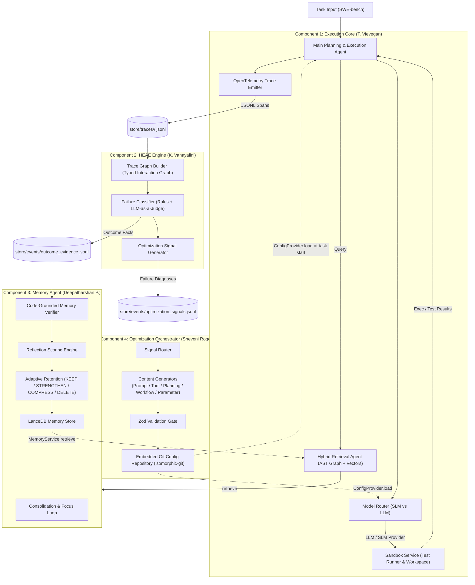

# Architecture: Self-Optimizing LLM Agent for Software Engineering Workflows

**Project ID**: J26-SE-339  
**Specification Reference**: Bucket 0 Final Decisions v1.0

---

## 1. System Overview

The system is a closed-loop, self-optimizing multi-agent framework designed to solve complex software engineering tasks (such as SWE-bench Lite benchmarks) and continuously improve performance without code redeployment.

Instead of retraining models or altering application code, the framework adapts runtime behavior through:

1. **Long-term code-grounded memory** (Memory Agent).
2. **Post-execution multi-label failure attribution** (HEAE).
3. **Versioned, schema-validated configuration updates** (Optimization Orchestrator).

---

## 2. Component Architecture & Responsibility Boundaries

### Component 1: Execution Core

- **Owner**: T. Vievegan (IT23259720)
- **Nature**: Autonomous Planning & Retrieval Agents + Deterministic Tooling
- **Key Responsibilities**:
  - Main Agent planning loop (tree search / react-style plan decomposition).
  - Hybrid code retrieval: tree-sitter AST syntax graph in Kùzu + LanceDB dense vector embeddings.
  - Model router: dynamic scoring deciding between SLM (`slm`: Qwen2.5-Coder-7B) and LLM (`llm`: Qwen2.5-Coder-32B).
  - Sandbox execution: runs commands and test suites against isolated task workspaces.
  - Instrumentation: emits OpenTelemetry spans for every step (`task`, `plan`, `retrieval`, `route`, `prompt`, `tool_call`, `output`).

### Component 2: Hierarchical Evaluation & Attribution Engine (HEAE)

- **Owner**: K. Vanayalini (IT23193840)
- **Nature**: Deterministic & Hybrid Evaluation Pipeline Service (Not an autonomous agent)
- **Key Responsibilities**:
  - Trace Graph Builder: ingests execution spans and constructs a typed interaction graph (`PromptNode`, `PlanNode`, `ToolCallNode`, `RetrievalNode`, `OutputNode`).
  - Failure Classifier: applies deterministic heuristic rules for clear errors and invokes LLM-as-a-judge for ambiguous, multi-causal failures across 5 failure classes (`prompt`, `tool`, `retrieval`, `planning`, `workflow`).
  - Emits:
    - `OutcomeEvidence`: objective task outcome facts, test counts, and memory citation history.
    - `OptimizationSignal`: structured diagnoses pointing to affected configuration paths. Emits diagnosis only; does not generate updated configuration content.

### Component 3: Code-Grounded Adaptive Memory Agent

- **Owner**: Deepatharshan P. (IT23190184)
- **Nature**: Autonomous Memory Governance Agent & Vector Store
- **Key Responsibilities**:
  - Dual working-to-long-term memory pipeline via `start_focus` / `complete_focus` loop.
  - Code-Grounded Memory Verification (CGMV): validates memories against target repository commits (`readFile`, `diff`, `runTests`).
  - Verification-informed reflection scoring: computes multidimensional scores (relevance, correctness, evidence, freshness, task contribution).
  - Outcome-guided adaptive retention: executes `KEEP`, `STRENGTHEN`, `COMPRESS`, `DELETE` (soft-delete tombstones for audit history).
  - Exposes `MemoryService` interface (`retrieve`, `consolidate`) to Execution Core.

### Component 4: Optimization Orchestrator

- **Owner**: Shevoni Rogers (IT22643254)
- **Nature**: Configuration-Driven Optimization Engine & Content Generators
- **Key Responsibilities**:
  - Signal Router: ingests `OptimizationSignal` records and dispatches to appropriate optimizer modules:
    - `prompt`: Prompt Optimizer (AutoPDL-style template mutation & few-shot injection).
    - `tool`: Tool Optimizer (updates tool descriptions, parameter schemas, and routing heuristics).
    - `planning`: Planning Optimizer (backtracking depth, subtask timeouts).
    - `workflow`: Workflow Optimizer (retry limits, max iterations).
    - `retrieval` / `routing`: Parameter Optimizer (retrieval thresholds, hybrid vector weights, routing threshold).
  - Validation Gate: enforces strict Zod schema constraints and numerical bounds.
  - Git Version Control: commits validated updates to `store/config/` using `isomorphic-git` (`cfg(<axis>): <signal_id>`), supporting instant atomic rollbacks.

---

## 3. Shared Store & Access Control

All shared state lives in the local filesystem under `store/` with strictly enforced single-writer access:

| Path under `store/`                 | Writer                    | Readers                            | Data Format / Type                |
| :---------------------------------- | :------------------------ | :--------------------------------- | :-------------------------------- |
| `traces/<run_id>/<task_id>.jsonl`   | Execution Core            | HEAE                               | JSON Lines (`TraceSpan`)          |
| `graphs/code/<repo>@<commit>.kuzu`  | Execution Core            | Exec Core, HEAE (read-only)        | Kùzu Graph DB                     |
| `graphs/heae.kuzu`                  | HEAE                      | HEAE                               | Kùzu Interaction Graph            |
| `vectors/code.lance`                | Execution Core            | Execution Core                     | LanceDB Vector Index              |
| `events/outcome_evidence.jsonl`     | HEAE                      | Memory Agent                       | JSON Lines (`OutcomeEvidence`)    |
| `events/optimization_signals.jsonl` | HEAE                      | Optimization Orchestrator          | JSON Lines (`OptimizationSignal`) |
| `memory/`                           | Memory Agent              | Exec Core (via MemoryService only) | LanceDB Notes & Audit Log         |
| `config/`                           | Optimization Orchestrator | All Components (read-only)         | Embedded Git Repo (`*.yaml`)      |
| `runs/<run_id>/metrics.jsonl`       | Eval Harness              | All Components                     | JSON Lines                        |
| `logs/<component>.jsonl`            | Each Component (own file) | All Components                     | Pino JSON Lines                   |

---

## 4. Shared Contracts & Schemas

Shared TypeScript contracts live in `packages/contracts/` and are validated by Zod:

1. **Trace Spans** (`packages/contracts/src/trace.ts`):
   - Typed spans: `task`, `plan`, `retrieval`, `route`, `prompt`, `tool_call`, `output`.
   - Causal edges represented by span links (`caused_by`).
2. **Outcome Evidence** (`packages/contracts/src/outcome-evidence.ts`):
   - Reports outcome facts (`resolved`, `tests_passed`, `tests_failed`, `patch_applied`), memory citations, failure labels, execution cost.
3. **Optimization Signal** (`packages/contracts/src/optimization-signal.ts`):
   - Emits structured diagnosis: `failure_class`, `root_cause`, `target` (`axis`, `config_path`, `affected_subtask`), `suggested_action`, `confidence`.
4. **Refined Memory** (`packages/contracts/src/refined-memory.ts`):
   - Structured note: `task`, `problem`, `cause`, `files`, `fix`, `evidence`, `verification`, `score`, `action` (`KEEP`, `STRENGTHEN`, `COMPRESS`, `DELETE`).
5. **Agent Configuration** (`packages/contracts/src/config.ts`):
   - Axis configurations: `planning.yaml`, `prompts.yaml`, `tools.yaml`, `retrieval.yaml`, `routing.yaml`, `workflow.yaml`.
   - Full configuration validation through `FullAgentConfigSchema`.
